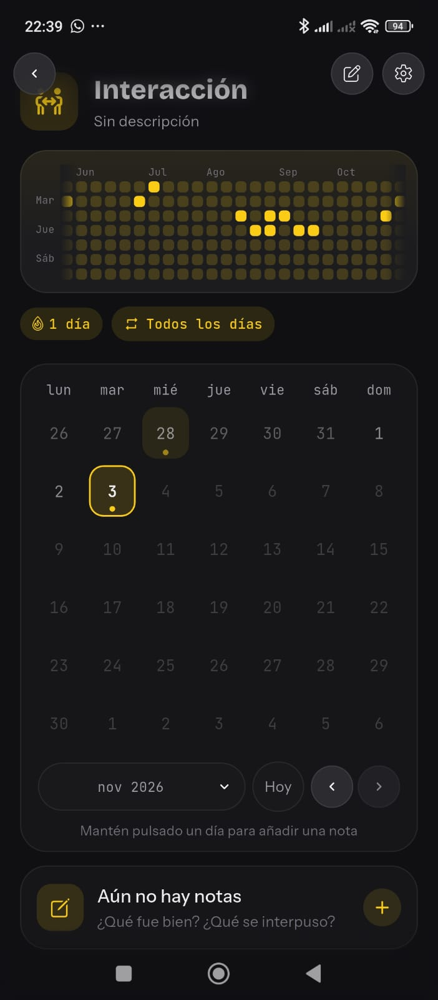
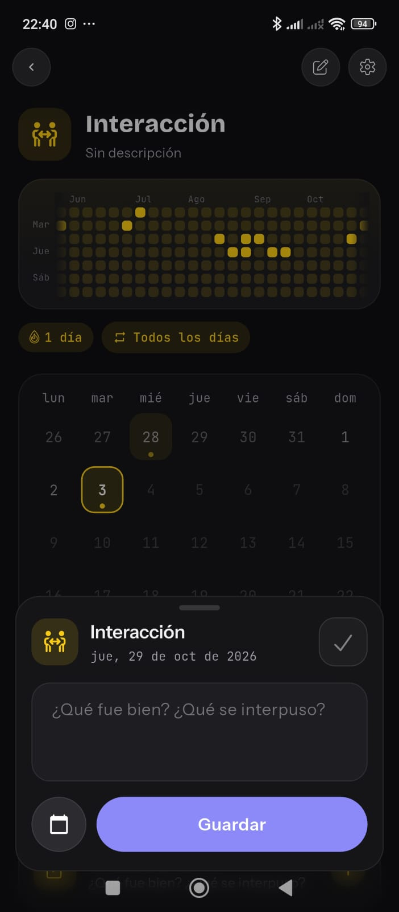

# Historias de usuario — calendario-cdccn

## Propósito del programa

Para ayudarme a socializar, quiero hacer una aplicación para poder visualizar y medir mis interacciones sociales.

---

## HU-01 — Contraseña

Quiero que al ingresar a la aplicación en el móvil me pida un **PIN de 4 dígitos** que yo escoja. El uso de la **huella dactilar** será **opcional**: en la pantalla del PIN habrá un botón de huella y el cuadro de huella solo aparecerá si lo pulso.

## HU-02 — Ajustes

Quiero que en los ajustes se pueda elegir el **modo de acceso**: **libre** (la app abre directo al calendario) o **protegido** (con PIN/huella). La app arranca en **modo libre**.

## HU-03 — Widgets

Quiero que tenga diferentes widgets para:

- Tomar nota del día.
- Marcar el día como realizado.

## HU-04 — Programa web

Quiero un programa web local donde, al igual que en la aplicación, pueda **modificar los días y sus notas**, y que también tenga **vista del calendario**.

## HU-05 — Características del día

Un día debe tener una **lista de características** (cosas que pasaron), por ejemplo:

- Sacar un contacto.
- Conocer a una nueva persona.
- Salir con alguien nuevo.

Las características **no se reflejan en los calendarios**. También podré **agregar y modificar** nuevos elementos de la lista.

## HU-06 — Notas

Para un día se podrán agregar **diferentes notas**, y cada nota podrá tener una **etiqueta**.

## HU-07 — Almacenamiento

Quiero que el almacenamiento sea **fácil de acceder** para la aplicación móvil y para el programa web, y que tenga **autoguardado**. Todos los datos se guardarán en **un solo archivo** en **Google Drive** (gratis), y la app funcionará **sin conexión**. En futuras actualizaciones se cambiará a una base de datos.

## HU-08 — Estadísticas

Agregar estadísticas, por ejemplo **gráfica lineal** o **gráfica de radar**, para ir checando mi progreso. Me gustaría tener un **sistema de puntaje**.

> 🟡 Pendiente: el sistema de puntaje queda para futuras actualizaciones.

## HU-09 — Eventos

Poder **"subrayar"** algún periodo de días y ponerle **nombre** a ese subrayado. Todos los eventos tendrán **un solo color** que armonice con el color principal.

> Ejemplo: del 4 al 7, "Viaje puerto".

## HU-10 — Visualización principal

Después de ingresar el PIN, quiero ver directamente el calendario como en las imágenes de referencia:

| Pantalla principal | Opciones del día |
|---|---|
|  |  |

- Un **mapa de actividad** como el gráfico de contribuciones de GitHub, que muestra **5 meses** y se puede desplazar, donde cada día se pinta según su **intensidad**.
- Cada día tiene **3 intensidades** que yo regulo: con cada **toque en el día** del calendario sube un nivel. El primer toque lo marca como realizado con la intensidad **mínima**.
- A la derecha de "Interacción" habrá un **ícono circular de palomita**; al apretarlo se marca el **día de hoy** de la misma forma (cada toque sube la intensidad).
- En el calendario mensual, la intensidad se muestra con **hasta 3 bolitas debajo del número** (1 bolita = intensidad 1, etc.).
- Una **racha** de días seguidos con actividad.
- Si **mantengo presionado un día**, se abren las opciones de ese día (con sus notas).
- Abajo del calendario habrá un botón **"Agregar nota nueva"** que abre el panel del **día de hoy** listo para escribir.
- Tocar un día futuro no hace nada (sin avisos).
- La pantalla principal queda **fija**: no se desliza si todo cabe en la pantalla.
- El color principal es el **amarillo** de las imágenes.

> El chip "Todos los días" de las imágenes no se incluye.
